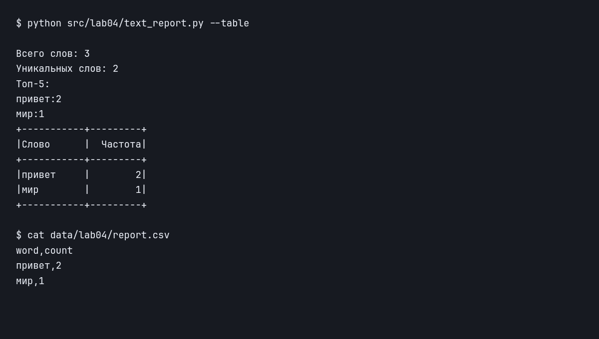
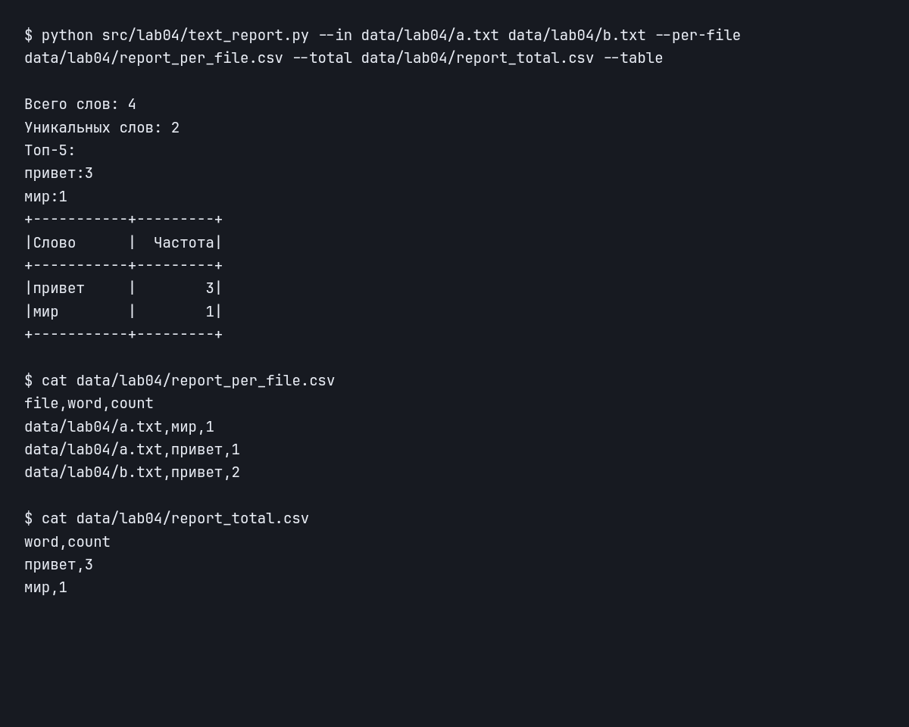

# ЛАБОРАТОРНАЯ РАБОТА №4

## ЗАДАНИЕ 1

### ФУНКЦИЯ 1

    def read_text(path: str | Path, encoding: str = "utf-8") -> str:
        p = Path(path)
        return p.read_text(encoding=encoding)

Принимаем на вход путь к файлу и его кодировку. Преобразуем путь через Path, читаем весь файл и возвращаем его содержимое одной строкой. По умолчанию используем utf-8, для другой кодировки передаём, например, encoding="cp1251". Если файл пустой, возвращаем пустую строку. Для больших файлов лучше читать текст построчно, чтобы не хранить его целиком в памяти.

### ФУНКЦИЯ 2

    def ensure_parent_dir(path: str | Path) -> None:
        p = Path(path)
        p.parent.mkdir(parents=True, exist_ok=True)

Получаем путь к файлу, берём его родительскую папку и создаём её. Через parents=True создаём все недостающие папки, а exist_ok=True позволяет не получать ошибку, если они уже существуют.

### ФУНКЦИЯ 3

    def write_csv(rows: Iterable[Sequence], path: str | Path,
                  header: tuple[str, ...] | None = None) -> None:
        rows = list(rows)

        check_rows = rows if header is None else [header] + rows
        for column in zip(*check_rows, strict=True):
            pass

        ensure_parent_dir(path=path)
        p = Path(path)

        with p.open("w", newline="", encoding="utf-8") as file:
            w = csv.writer(file)
            if header is not None:
                w.writerow(header)

            for r in rows:
                w.writerow(r)

Принимаем строки, путь к файлу и необязательный заголовок. Превращаем строки в список, добавляем заголовок к проверке, если он есть. Через zip со strict=True проверяем, чтобы все строки были одинаковой длины. Если длина разная, получаем ValueError ещё до открытия файла, поэтому старое содержимое не стирается.

Создаём нужные папки, открываем файл на запись в utf-8. Сначала записываем заголовок, если он передан, затем проходимся по всем строкам и записываем их через csv.writer. Если строки пустые, получаем пустой файл, а при наличии заголовка — только заголовок.

## ЗАДАНИЕ 2

### ФУНКЦИЯ 1

    def frequencies_from_text(text: str) -> dict[str, int]:
        tokens = tokenize(normalize(text))
        return count_freq(tokens)

Получаем текст, нормализуем его и разбиваем на слова. Используем normalize, tokenize и count_freq из третьей лабораторной, чтобы посчитать, сколько раз встретилось каждое слово.

### ФУНКЦИЯ 2

    def sorted_word_counts(freq: dict[str, int]) -> list[tuple[str, int]]:
        return sorted(freq.items(), key=lambda x: (-x[1], x[0]))

Принимаем словарь частот, превращаем его в список пар и сортируем по ключу (-x[1], x[0]). Сначала идут слова с большей частотой, а если частоты одинаковые, сортируем слова по алфавиту.

### ОДИН ФАЙЛ

    text = '\n'.join(texts)
    counts = frequencies_from_text(text)
    rows = sorted_word_counts(counts)

    write_csv(rows, path, header=('word', 'count'))

    print(f'Всего слов: {sum(counts.values())}')
    print(f'Уникальных слов: {len(counts)}')
    print('Топ-5:')
    for word, count in top_n(counts, n=5):
        print(f'{word}:{count}')

Читаем входной файл, считаем частоты слов и сортируем их. Записываем результат в CSV с колонками word,count. В консоль выводим общее количество слов, количество уникальных слов и топ-5 через top_n из третьей лабораторной.

Все команды запускаем из корня репозитория:

    python src/lab04/text_report.py
    python src/lab04/text_report.py --in data/lab04/input.txt --out data/lab04/report.csv

Без параметров читаем data/lab04/input.txt и записываем data/lab04/report.csv. На вход подаём «Привет, мир! Привет!!!», получаем слово «привет» с частотой 2 и слово «мир» с частотой 1. Если входной файл пустой, в отчёте остаётся только заголовок word,count, а количество слов равно нулю.

### ОБРАБОТКА ОШИБОК

    except FileNotFoundError as error:
        print(f'Ошибка: файл не найден: {error.filename}', file=sys.stderr)
        return 1
    except UnicodeDecodeError:
        print('Ошибка: не удалось прочитать текст. Проверьте --encoding (например, cp1251).',
              file=sys.stderr)
        return 1
    except LookupError:
        print(f'Ошибка: неизвестная кодировка: {args.encoding}', file=sys.stderr)
        return 1
    except (OSError, ValueError, csv.Error) as error:
        print(f'Ошибка при создании отчёта: {error}', file=sys.stderr)
        return 1

Чтение файлов и запись отчётов выполняем внутри try. Если файл не найден, кодировка не подходит или не получается записать CSV, попадаем в соответствующий except. Выводим сообщение об ошибке и возвращаем 1, после чего sys.exit завершает программу с этим кодом. При успешной работе возвращаем 0.

Кодировку задаём через --encoding. Например, для файла, который заранее сохранили в cp1251:

    python src/lab04/text_report.py --in data/lab04/input_cp1251.txt --encoding cp1251

## ЗАДАНИЯ СО ЗВЁЗДОЧКОЙ

### НЕСКОЛЬКО ФАЙЛОВ

    texts = []
    per_file = []
    for path in sorted(set(args.inputs)):
        text = read_text(path, encoding=args.encoding)
        texts.append(text)
        counts = frequencies_from_text(text)

        for word, count in sorted_word_counts(counts):
            per_file.append((str(Path(path)), word, count))

    per_file.sort(key=lambda x: (x[0], -x[2], x[1]))

Получаем несколько путей через --in. Убираем повторяющиеся пути через set, сортируем их и проходимся по каждому файлу. Читаем текст и отдельно считаем частоты. К каждому слову добавляем путь к файлу, затем сортируем строки по пути, частоте по убыванию и слову по алфавиту.

Записываем отдельный отчёт с колонками file,word,count. Все прочитанные тексты соединяем через перенос строки и считаем общую статистику. Её записываем в сводный отчёт с колонками word,count.

    python src/lab04/text_report.py --in data/lab04/a.txt data/lab04/b.txt --per-file data/lab04/report_per_file.csv --total data/lab04/report_total.csv --table

В a.txt записано «Привет мир», в b.txt — «Привет, привет!». В сводном отчёте получаем «привет» с частотой 3 и «мир» с частотой 1. Если пути для отчётов не переданы, создаём data/lab04/report_per_file.csv и data/lab04/report_total.csv.

### С ТАБЛИЦЕЙ

    if args.table:
        print(text_statistic(text, table_form=True))

Если передали --table, вызываем text_statistic из общего модуля src/lib/text_stats.py с table_form=True. Находим максимальную длину слова и количества повторений, строим рамку и выводим все слова с их частотами. Слова выравниваем влево, числа вправо. Для пустого текста выводим только рамку и заголовки.

    python -m src.lab04.text_report --table

В папки src, lib и лабораторных добавлены __init__.py, чтобы можно было импортировать их как модули. Ввод текста и запуск программы находятся под проверкой __name__ == '__main__', поэтому при импорте они не выполняются.
