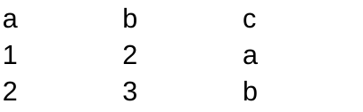

# ЛАБОРАТОРНАЯ РАБОТА №5

## ЗАДАНИЕ А 

### ФУНКЦИЯ 1

    def json_to_csv(json_path: str, csv_path: str) -> None:

        if Path(json_path).suffix.lower() != ".json":
            raise ValueError("Входной файл должен быть JSON")
        if Path(csv_path).suffix.lower() != ".csv":
            raise ValueError("Выходной файл должен быть CSV")

        with open(json_path, mode='r', encoding='UTF-8') as file:
            text = json.load(file)

        if (
            not isinstance(text, list)
            or not text
            or not all(isinstance(item, dict) for item in text)
        ):
            raise ValueError("Пустой JSON или плохой формат")

        header = set()
        for item in text:
            for key in item:
                header.add(key)

        header = sorted(header)
        if not header:
            raise ValueError("JSON не содержит полей для CSV")
        if any(not key.strip() for key in header):
            raise ValueError("Названия полей JSON не должны быть пустыми")

        rows = []
        for item in text:
            row = []
            for key in header:
                row.append(item.get(key, ""))
            rows.append(row)

        write_csv(rows, csv_path, header=tuple(header))

Принимаем путь к JSON и путь к выходному CSV. Через Path(...).suffix.lower() проверяем расширения файлов. Открываем JSON для чтения и вызываем json.load(file), чтобы получить Python-объект из содержимого файла.

Проверяем, что получили непустой список, каждый элемент которого является словарём. Для проверки используем isinstance и all. Если структура не подходит, вызываем ValueError.

Создаём множество header и собираем в него ключи из всех словарей. Множество убирает повторения, а sorted располагает названия по алфавиту. В этой реализации порядок колонок всегда алфавитный, даже если ключи в исходном JSON записаны иначе. Пустые названия полей и список без полей отклоняем.

Затем отдельно собираем строки. Для каждого словаря проходимся по общему заголовку и через item.get(key, "") получаем значение. Если ключа нет, подставляем пустую строку. Так все строки получаются одинаковой длины, а значения попадают в нужные колонки, даже если дополнительные ключи встретились только в последнем объекте.

Передаём строки, выходной путь и заголовок в write_csv. Эта функция создаёт недостающие папки и записывает CSV с заголовком, разделителем-запятой и кодировкой UTF-8.

==================================================================================

В файле [data/samples/a.json](../../data/samples/a.json) находятся два объекта:

    [
        {"a": 1, "b": 2, "c": "a"},
        {"a": 2, "b": 3, "c": "b"}
    ]

Запускаем:

    python -c "from src.lab05.json_csv import json_to_csv; json_to_csv('data/samples/a.json', 'data/out/a_from_json.csv')"

В data/out/a_from_json.csv получаем:

    a,b,c
    1,2,a
    2,3,b

Количество записей сохраняется: два объекта JSON превращаются в две строки данных CSV. Заголовок записывается отдельно и в количество записей не входит.

Если у второго объекта появляется дополнительный ключ, например:

    [
        {"name": "igor", "age": 25},
        {"name": "anton", "age": 15, "city": "Moscow"}
    ]

Результат будет таким:

    age,city,name
    25,,igor
    15,Moscow,anton

Для первого человека поля city нет, поэтому между запятыми остаётся пустое значение. Ключи age, city, name расположены по алфавиту.

### ФУНКЦИЯ 2

    def csv_to_json(csv_path: str, json_path: str) -> None:
        if Path(csv_path).suffix.lower() != ".csv":
            raise ValueError("Входной файл должен быть CSV")
        if Path(json_path).suffix.lower() != ".json":
            raise ValueError("Выходной файл должен быть JSON")

        with open(csv_path, "r", encoding="utf-8", newline="") as file:
            reader = csv.reader(file)
            keys = next(reader, None)

            if not keys or any(not key.strip() for key in keys):
                raise ValueError("CSV пустой или отсутствует заголовок")
            if len(set(keys)) != len(keys):
                raise ValueError("Названия колонок CSV не должны повторяться")

            text = []
            for row in reader:
                text.append(dict(zip(keys, row, strict=True)))

        Path(json_path).parent.mkdir(parents=True, exist_ok=True)
        with open(json_path, "w", encoding="utf-8") as file:
            json.dump(text, file, ensure_ascii=False, indent=2)

Проверяем расширения входного и выходного файлов. Открываем CSV с newline="", чтобы обработкой переводов строк занимался модуль csv. Через csv.reader получаем записи в виде списков строк. Значения с запятыми, кавычками и переносами строк внутри корректно оформленного CSV также читаются этим модулем.

Вызов next(reader, None) забирает первую запись, которую принимаем за заголовок. Если файл пустой, получаем None. Проверяем, что заголовок есть, его названия не пустые и не повторяются. Первая запись считается заголовком по соглашению: определить по произвольному тексту, является ли она заголовком или данными, функция не может.

Для каждой следующей записи zip(keys, row, strict=True) соединяет название колонки с соответствующим значением. Например, списки ["name", "age"] и ["igor", "25"] превращаются в пары ("name", "igor") и ("age", "25"). Через dict создаём из них словарь и добавляем его в список text. Параметр strict=True вызывает ValueError, если число значений не совпадает с числом колонок.

Создаём выходную папку и записываем список словарей через json.dump. С ensure_ascii=False русские буквы сохраняются напрямую, а indent=2 добавляет переносы строк и отступы в два пробела. Все значения остаются строками: числа автоматически не восстанавливаем.

==========================================================================

В файле [data/samples/a.csv](../../data/samples/a.csv) находятся:

    a,b,c
    1,2,a
    2,3,b

Запускаем:

    python -c "from src.lab05.json_csv import csv_to_json; csv_to_json('data/samples/a.csv', 'data/out/a_from_csv.json')"

В data/out/a_from_csv.json получаем:

    [
      {
        "a": "1",
        "b": "2",
        "c": "a"
      },
      {
        "a": "2",
        "b": "3",
        "c": "b"
      }
    ]

Две строки данных CSV превращаются в два словаря. Названия a, b, c становятся ключами. Числа записаны в кавычках, потому что CSV читается как текст. Поэтому после JSON → CSV → JSON числовые значения становятся строками, а отсутствующие поля — пустыми строками. Полное восстановление исходных типов данных не выполняем.

## ЗАДАНИЕ Б

Из openpyxl импортируем Workbook для создания книги Excel и get_column_letter для получения буквенного обозначения колонки по её номеру.

### ФУНКЦИЯ 1

    def csv_to_xlsx(csv_path: str, xlsx_path: str) -> None:
        if Path(csv_path).suffix.lower() != ".csv":
            raise ValueError("Входной файл должен быть CSV")
        if Path(xlsx_path).suffix.lower() != ".xlsx":
            raise ValueError("Выходной файл должен быть XLSX")

        with open(csv_path, "r", encoding="utf-8", newline="") as file:
            rows = list(csv.reader(file))

        if not rows or not rows[0] or any(not key.strip() for key in rows[0]):
            raise ValueError("CSV пустой или отсутствует заголовок")
        if len(set(rows[0])) != len(rows[0]):
            raise ValueError("Названия колонок CSV не должны повторяться")
        for row in rows[1:]:
            if len(row) != len(rows[0]):
                raise ValueError("Число значений в строке CSV не совпадает с заголовком")

        wb = Workbook()
        ws = wb.active
        ws.title = "Sheet1"

        for row in rows:
            ws.append(row)

        for column in ws.columns:
            max_length = 0

            for cell in column:
                if cell.value is not None:
                    max_length = max(max_length, len(str(cell.value)))

            letter = get_column_letter(column[0].column)
            ws.column_dimensions[letter].width = max(8, max_length + 2)

        Path(xlsx_path).parent.mkdir(parents=True, exist_ok=True)
        wb.save(xlsx_path)

Принимаем путь к CSV и путь к XLSX. Проверяем расширения, читаем CSV и сохраняем записи в список rows. Первая запись — заголовок. Проверяем, что файл и названия колонок не пустые, названия не повторяются, а количество значений в каждой строке совпадает с количеством колонок.

Создаём книгу через Workbook(). В wb.active получаем первый лист и задаём ему имя Sheet1. Проходимся по rows и добавляем записи через ws.append(row). Заголовок переносим первой строкой, затем записываем данные. Значения CSV сохраняем в ячейках как строки.

Для подбора ширины перебираем колонки через ws.columns. В каждой колонке находим максимальную длину текста, включая заголовок. None пропускаем, а остальные значения переводим в строку перед вызовом len. Через get_column_letter получаем обозначение колонки: 1 превращается в A, 2 — в B, 27 — в AA.

Ширину устанавливаем по формуле max(8, max_length + 2): добавляем запас в два символа и не допускаем ширину меньше 8. Это подбор по длине текста, без измерения шрифта. После создания нужной папки сохраняем книгу через wb.save(xlsx_path).

====================================================================

Используем тот же файл data/samples/a.csv:

    python -c "from src.lab05.csv_xlsx import csv_to_xlsx; csv_to_xlsx('data/samples/a.csv', 'data/out/a.xlsx')"

В [data/out/a.xlsx](../../data/out/a.xlsx) получаем лист Sheet1 с таблицей:

| a | b | c |
| --- | --- | --- |
| 1 | 2 | a |
| 2 | 3 | b |

В книге три строки с учётом заголовка и три колонки. Максимальная длина значения в каждой колонке равна одному символу, поэтому ширина A, B и C устанавливается в 8.

