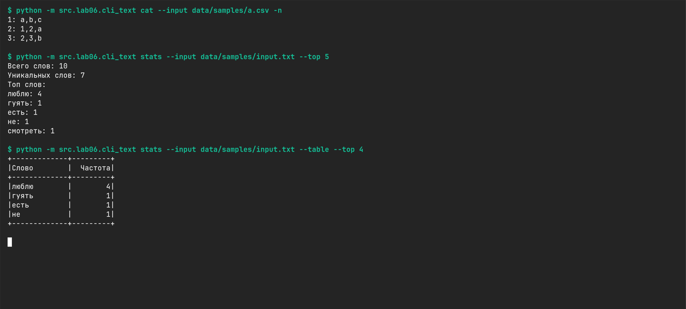
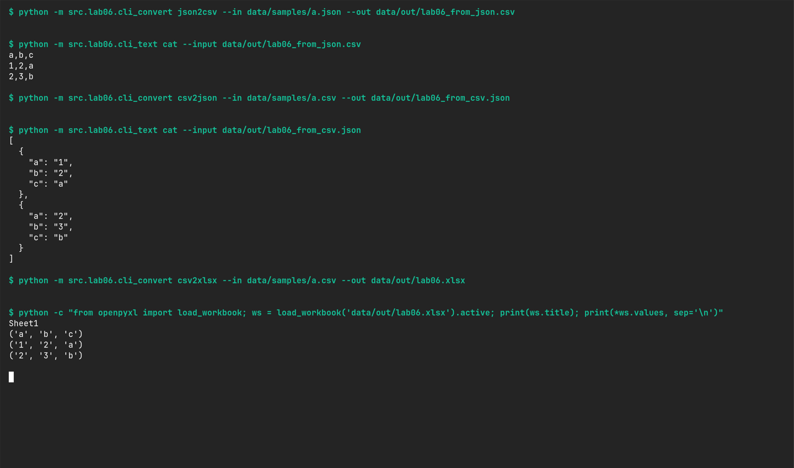

# ЛАБОРАТОРНАЯ РАБОТА №6

## ЗАДАНИЕ А — РАБОТА С ТЕКСТОМ

В файле [cli_text.py](cli_text.py) создаём парсер и подкоманды:

```python
parser = argparse.ArgumentParser(description="CLI‑утилиты лабораторной №6")
subparsers = parser.add_subparsers(dest="command")
args = parser.parse_args()
```

Между созданием `subparsers` и вызовом `parse_args()` описываем команды через `add_parser()` и их параметры через `add_argument()`. Выбранная команда сохраняется в `args.command`, а значения параметров — в остальных полях `args`.

### ПОДКОМАНДА CAT

```python
path = Path(args.input)

with path.open(encoding="utf-8") as file:
    for number, line in enumerate(file, start=1):
        if args.n:
            print(f"{number}: {line}", end="")
        else:
            print(line, end="")
```

Через обязательный `--input` получаем путь к текстовому файлу. Читаем его построчно в UTF-8. Флаг `-n` с `action="store_true"` включает нумерацию: `enumerate` считает строки с единицы. Через `end=""` убираем дополнительный перенос от `print`.

```bash
python -m src.lab06.cli_text cat --input data/samples/a.csv -n
```

Получаем заголовок CSV и две строки данных с номерами от 1 до 3. Без `-n` выводим только содержимое файла.

### ПОДКОМАНДА STATS

```python
path = Path(args.input)

with path.open(encoding='utf-8') as file:
    text = file.read()

print(text_statistic(text=text, n=args.top, table_form=args.table_form))
```

Читаем текст по пути `--input` и передаём в `text_statistic` из `src/lib/text_stats.py`. Эта функция использует нормализацию и подсчёт частот из ЛР3. Через `--top` задаём количество слов, по умолчанию 5. Флаг `-table` включает табличный вывод.

```bash
python -m src.lab06.cli_text stats --input data/samples/input.txt --top 5
python -m src.lab06.cli_text stats --input data/samples/input.txt -table --top 4
```

В `input.txt` получаем 10 слов и 7 уникальных. Слово «люблю» встречается 4 раза, остальные — по одному. При одинаковой частоте слова сортируются по алфавиту. В таблице выводим четыре слова.



## ЗАДАНИЕ Б — КОНВЕРТАЦИЯ ФАЙЛОВ

В файле [cli_convert.py](cli_convert.py) создаём три подкоманды: `json2csv`, `csv2json` и `csv2xlsx`. У каждой обязательны `--in` и `--out` — пути к входному и выходному файлам.

```python
pJ2C = sub.add_parser("json2csv")
pJ2C.add_argument("--in", dest="input", required=True)
pJ2C.add_argument("--out", dest="output", required=True)
```

Аналогично описываем две остальные команды. Через `dest` сохраняем пути в `args.input` и `args.output`. Выбранная подкоманда находится в `args.cmd`.

```python
if args.cmd == "json2csv":
    json_to_csv(args.input, args.output)
elif args.cmd == "csv2json":
    csv_to_json(args.input, args.output)
elif args.cmd == "csv2xlsx":
    csv_to_xlsx(args.input, args.output)
```

Вызываем готовые функции из ЛР5, которые читают исходные данные и записывают результат. Для XLSX используется `openpyxl` из ЛР5.

```bash
python -m src.lab06.cli_convert json2csv --in data/samples/a.json --out data/out/lab06_from_json.csv
python -m src.lab06.cli_convert csv2json --in data/samples/a.csv --out data/out/lab06_from_csv.json
python -m src.lab06.cli_convert csv2xlsx --in data/samples/a.csv --out data/out/lab06.xlsx
```

В [CSV](../../data/out/lab06_from_json.csv) получаем заголовок `a,b,c` и две строки данных. В [JSON](../../data/out/lab06_from_csv.json) — два словаря со строковыми значениями. В [XLSX](../../data/out/lab06.xlsx) — лист `Sheet1` с тремя строками и тремя колонками, включая заголовок.

Конвертеры ничего не печатают при успехе. На скриншоте после запуска отдельно читаем созданные файлы, чтобы проверить содержимое.


