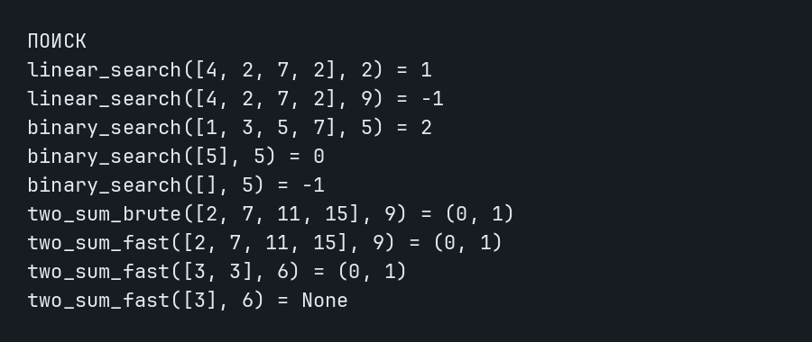
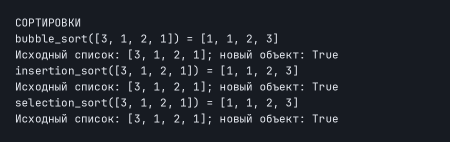
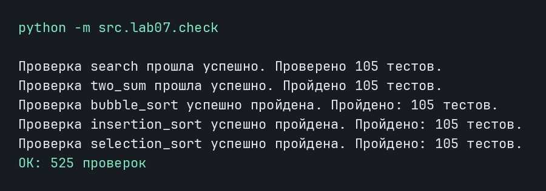
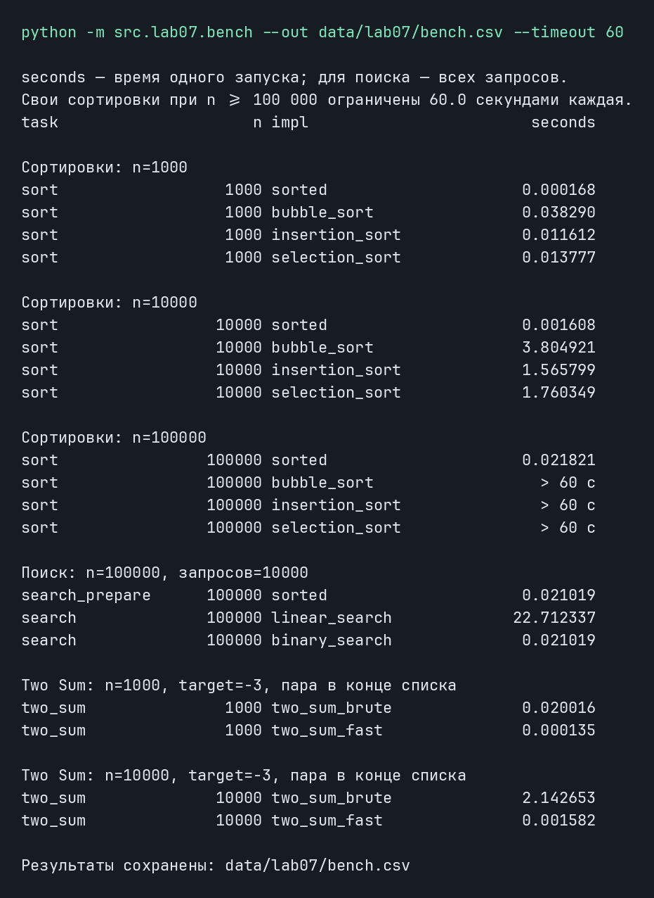

# ЛАБОРАТОРНАЯ РАБОТА №7

## ЗАДАНИЕ А — ПОИСК

### ЛИНЕЙНЫЙ ПОИСК

```python
def linear_search(nums: list[int | float], x: int | float) -> int:
    for index in range(len(nums)):
        if nums[index] == x:
            return index
    return -1
```

Проходим по индексам списка и сравниваем каждый элемент с x. При первом совпадении возвращаем индекс. Если дошли до конца и ничего не нашли, возвращаем -1. При повторах получаем именно первое вхождение. В худшем случае проверяем все n элементов, поэтому сложность равна O(n).

### БИНАРНЫЙ ПОИСК

```python
def binary_search(sorted_nums: list[int | float], x) -> int:
    low = 0
    higth = len(sorted_nums) - 1
    while low <= higth:
        middle = (low + higth) // 2
        if sorted_nums[middle] == x:
            return middle
        elif sorted_nums[middle] < x:
            low = middle + 1
        else:
            higth = middle - 1
    return -1
```

Принимаем список, уже отсортированный по возрастанию. Через low и higth задаём включительные границы поиска. Пока low <= higth, вычисляем средний индекс и сравниваем элемент с x. Если x больше, переносим левую границу на middle + 1, иначе переносим правую на middle - 1. Проверенную середину исключаем из дальнейшего поиска.

Равенство в условии цикла позволяет проверить последний оставшийся элемент. Если диапазон стал пустым, возвращаем -1. При нескольких одинаковых значениях допустим любой подходящий индекс. На неотсортированном списке результат не определён. Каждый шаг уменьшает диапазон примерно вдвое, поэтому сложность равна O(log n).

### TWO SUM — ПЕРЕБОР ПАР

```python
def two_sum_brute(nums: list[int | float], target: int | float) -> tuple[int, int] | None:
    for first in range(len(nums)):
        for second in range(first + 1, len(nums)):
            if nums[first] + nums[second] == target:
                return (first, second)
    return None
```

Перебираем первый индекс, затем второй начиная с first + 1. Так индексы всегда различаются и first < second. При нужной сумме возвращаем пару индексов, а при отсутствии решения — None. В худшем случае проверяем n(n - 1) / 2 пар, поэтому время растёт как O(n²).

### TWO SUM — СЛОВАРЬ

```python
def two_sum_fast(nums: list[int | float], target: int | float) -> tuple[int, int] | None:
    seens = {}
    for j, x in enumerate(nums):
        need = target - x
        if need in seens:
            return (seens[need], j)
        seens[x] = j
    return None
```

В словаре seens сохраняем соответствие «число → индекс». Для очередного x вычисляем недостающее число target - x. Если оно уже встречалось, возвращаем сохранённый индекс и текущий j. Проверку выполняем до записи x, поэтому один элемент не используется дважды. Два одинаковых элемента, например [3, 3] при target = 6, дают правильную пару (0, 1).

Список проходим один раз. Поиск ключа в словаре в среднем занимает O(1), поэтому среднее время равно O(n), дополнительная память — O(n). Ниже приведён фактический вывод вызовов функций после исправления названий.



## ЗАДАНИЕ Б — СОРТИРОВКИ

### ПУЗЫРЬКОМ

```python
def bubble_sort(nums: list[int | float]) -> list[int | float]:
    nums = list(nums)
    for end in range(len(nums) - 1, 0, -1):
        swapped = False
        for j in range(end):
            if nums[j] > nums[j + 1]:
                nums[j], nums[j + 1] = nums[j + 1], nums[j]
                swapped = True
        if not swapped:
            break
    return nums
```

Сначала создаём копию входного списка через list(nums). Сравниваем соседние элементы nums[j] и nums[j + 1] и меняем их местами, если порядок неправильный. После прохода наибольший элемент оставшейся части оказывается справа, поэтому end уменьшается.

Флаг swapped показывает, были ли обмены. Если обменов не было, список уже отсортирован и завершаем работу. На отсортированном списке время равно O(n), в среднем и в худшем случае — O(n²). В отличие от прежней реализации здесь сравниваются именно соседи.

### ВСТАВКАМИ

```python
def insertion_sort(nums: list[int | float]) -> list[int | float]:
    nums = list(nums)
    for i in range(1, len(nums)):
        current = nums[i]
        j = i - 1
        while j >= 0 and nums[j] > current:
            nums[j + 1] = nums[j]
            j -= 1
        nums[j + 1] = current
    return nums
```

Начинаем со второго элемента и сохраняем его значение в current. Слева находится уже упорядоченная часть. Пока элемент слева больше current, сдвигаем его вправо и уменьшаем j. После остановки вставляем current на позицию j + 1. На отсортированном списке сдвигов нет и время равно O(n), в худшем случае — O(n²).

### ВЫБОРОМ

```python
def selection_sort(nums: list[int | float]) -> list[int | float]:
    nums = list(nums)
    for i in range(len(nums) - 1):
        min_index = i
        for j in range(i +  1, len(nums)):
            if nums[j] < nums[min_index]:
                min_index = j
        nums[i], nums[min_index] = nums[min_index], nums[i]
    return nums
```

Для каждой позиции i ищем индекс минимального элемента в оставшейся части списка. После внутреннего цикла меняем найденный минимум с элементом на позиции i. Обмен выполняем один раз после поиска минимума. Число сравнений остаётся квадратичным даже для отсортированного списка.

Все три функции возвращают новый список и сохраняют исходный. Пустой список, один элемент, отрицательные числа и повторы обрабатываются. Внутри алгоритмов не используем sorted, sort, min и max. На изображении проверяем результат и отдельно выводим исходный список.



## ЗАДАНИЕ В — ПРОВЕРКА ПРОТИВ ЭТАЛОНА

### ПОИСК

В check.py импортируем функции из search.py и sorting.py. Перед определениями функций создаём общий счётчик:

```python
checks_count = 0
```

```python
def check_search(trials = 100) -> None:
    global checks_count
    cases = [[], [4], [1, 2], [1, 1, 1, 5], [-5, 0 , 0 , 7]]

    for _ in range(trials):
        n = random.randint(0, 50)
        nums = [random.randint(-100, 100) for _ in range(n)]
        cases.append(nums)

    for nums in cases:

        ordered = sorted(nums)
        targets = set(nums) | {-101, 101}

        for number in targets:
            try:
                expected = nums.index(number)
            except ValueError:
                expected = -1

            result = linear_search(nums, number)
            assert result == expected, (
                f'Ошибка в linear_search: {nums} target: {number}.'
                f'Ожидалось: {expected}, получено: {result}'
            )

            result = binary_search(ordered, number)
            if expected == -1:
                assert result == -1, (
                    f'binary_search нашла отсутствующее число: '
                    f'nums={ordered}, target={number}, result={result}'
                )
            else:
                assert 0 <= result < len(ordered), (
                    f'binary_search вернула неверный индекс: '
                    f'nums={ordered}, target={number}, result={result}'
                )
                assert ordered[result] == number, (
                    f'Ошибка в binary_search: nums={ordered}, '
                    f'target={number}, result={result}'
                )

    checks_count += len(cases)
    print(f'Проверка search прошла успешно. Проверено {len(cases)} тестов.')
    return None
```

Создаём пять фиксированных списков и trials случайных списков длиной от 0 до 50 со значениями от -100 до 100. Множество targets содержит все присутствующие значения и заведомо отсутствующие -101 и 101. Поэтому проверяются пустой список, крайние элементы и отсутствие результата.

Линейный поиск сравниваем с list.index, заменяя ValueError на ожидаемое -1. Для бинарного поиска сортируем список. Если число присутствует, проверяем границы индекса и значение по нему, поскольку при повторах допустим любой подходящий индекс. Через assert останавливаем программу на первом расхождении и показываем данные.

### TWO SUM

```python
def check_two_sum(trials = 100) -> None:
    global checks_count
    cases = [([], 0), ([3], 5), ([3, 3], 6), ([1, 2], 10), ([-3, 4, 2], -1)]
    for _ in range(trials):
        n = random.randint(0, 50)
        nums = [random.randint(-100, 100) for _ in range(n)]
        target = random.randint(-200, 200)
        cases.append((nums, target))

    for nums, target in cases:
        brute = two_sum_brute(nums, target)
        fast = two_sum_fast(nums, target)

        assert (brute is None) == (fast is None), (
            f'Ошибка. nums: {nums}, target: {target}.'
            f'brute: {brute}, fast: {fast}'
        )

        for name, result in (("brute", brute), ("fast", fast)):
            if result is not None:
                i, j = result

                assert 0 <= i < j < len(nums), (
                    f'{name}: неверные индексы {result}, nums={nums}'
                )
                assert nums[i] + nums[j] == target, (
                    f'Ошибка {name}: неверная сумма {result}.'
                    f'nums: {nums}, target: {target}'
                )

    checks_count += len(cases)
    print(f'Проверка two_sum прошла успешно. Пройдено {len(cases)} тестов.')
    return None
```

Для каждого списка и target запускаем оба решения. Проверяем, что они либо оба вернули None, либо оба нашли пару. Найденные индексы должны удовлетворять 0 <= i < j < len(nums), а сумма элементов должна равняться target. Сами пары могут отличаться, если правильных ответов несколько.

### СОРТИРОВКИ

```python
def check_sorting(fn, trials = 100) -> None:
    global checks_count
    cases = [[], [5], [2, 2], [3, 2, 1], [-2, 0, -5, 0]]

    for _ in range(trials):
        n = random.randint(0, 50)
        nums = [random.randint(-100, 100) for _ in range(n)]
        cases.append(nums)

    for nums in cases:
        original = list(nums)
        expected = sorted(original)
        result = fn(nums)

        assert result == expected, (
            f'Ошибка в {fn.__name__}: {original}.'
            f'Ожидалось: {expected}, получено: {result}'
        )
        assert nums == original, (
            f'{fn.__name__} изменила исходный список {original}'
        )
        assert result is not nums, (
            f'{fn.__name__} должна возвращать новый список'
        )
    checks_count += len(cases)
    print(f'Проверка {fn.__name__} успешно пройдена. Пройдено: {len(cases)} тестов.')
```

Для каждой сортировки выполняем 100 случайных и 5 фиксированных случаев. Сохраняем original, вычисляем эталон через sorted и запускаем проверяемую функцию. Проверяем совпадение результата, сохранность входного списка и то, что возвращён другой объект.

В каждой функции global checks_count позволяет увеличить общий счётчик после успешного завершения группы. Одной проверкой в итоговой строке считаем один входной набор: для поиска и Two Sum на нём проверяются оба алгоритма, для сортировок — одна переданная функция.

```python
if __name__ == "__main__":
    random.seed(67)
    check_search()
    check_two_sum()
    for fun in (bubble_sort, insertion_sort, selection_sort):
        check_sorting(fn=fun)
    print(f'OK: {checks_count} проверок')
```

Запускаем из корня репозитория:

```bash
python -m src.lab07.check
```

Получаем 105 наборов для поиска, 105 для Two Sum и по 105 для трёх сортировок: всего 525 проверок, включая 500 случайных и 25 фиксированных. В текущем запуске расхождений нет. В ходе работы исправлены граница бинарного поиска, использование словаря в Two Sum, сдвиг во вставках и реализация пузырька. Названия функций приведены к заданию, а итоговая строка теперь содержит число проверок.



## ЗАДАНИЕ Г — БЕНЧМАРК

### ОГРАНИЧЕНИЕ ВРЕМЕНИ

```python
def measure_sort(fn, data, timeout=60):
    if not isfinite(timeout) or timeout <= 0:
        raise ValueError("timeout должен быть положительным конечным числом")

    def stop_sorting(signum, frame):
        raise TimeoutError("Превышен лимит времени сортировки")

    previous_handler = signal.signal(signal.SIGALRM, stop_sorting)
    try:
        signal.setitimer(signal.ITIMER_REAL, timeout)
        return timeit.timeit(lambda: fn(data), number=1)
    except TimeoutError:
        return f"> {timeout:g} с"
    finally:
        signal.setitimer(signal.ITIMER_REAL, 0)
        signal.signal(signal.SIGALRM, previous_handler)
```

Проверяем, что timeout положительный и конечный: ноль отключил бы таймер, а отрицательные значения, nan и бесконечность не подходят для лимита. isfinite импортируем из math. Для SIGALRM временно устанавливаем обработчик stop_sorting, который выбрасывает TimeoutError. Через setitimer включаем отсчёт реального времени и запускаем сортировку внутри timeit.

Если функция успела завершиться, возвращаем секунды. Если время истекло, исключение прерывает сортировку и вместо числа возвращаем строку с превышенным лимитом. В finally выключаем таймер и восстанавливаем обработчик даже при ошибке. Этот вариант используется в главном потоке на Linux.

### СОРТИРОВКИ

```python
def bench_sorts(n, timeout):
    data = [random.randint(-n, n) for _ in range(n)]
    rows = []

    seconds = timeit.timeit(lambda: sorted(data), number=10) / 10
    rows.append(("sort", n, "sorted", seconds))

    for fn in (bubble_sort, insertion_sort, selection_sort):
        if n >= 100_000:
            seconds = measure_sort(fn, data, timeout)
        else:
            seconds = timeit.timeit(lambda: fn(data), number=1)
        rows.append(("sort", n, fn.__name__, seconds))

    return rows
```

Для каждого n создаём один случайный список и передаём его всем сортировкам. Встроенный sorted запускаем 10 раз и делим общее время на 10, чтобы получить среднее время одного запуска. Свои функции запускаем по одному разу. На 100 000 элементах каждую свою сортировку ограничиваем переданным timeout.

Данные генерируются до вызова timeit, поэтому их создание не включено в замер. Копирование внутри своих сортировок входит в измеряемое время. В rows сохраняем кортежи с задачей, размером, именем реализации и секундами.

### ПОИСК

```python
def bench_search(n=SEARCH_SIZE, queries_count=SEARCH_QUERIES):
    data = [random.randint(-n, n) for _ in range(n)]
    queries = [random.randint(-n, n) for _ in range(queries_count)]

    seconds = timeit.timeit(lambda: sorted(data), number=10) / 10
    rows = [("search_prepare", n, "sorted", seconds)]
    ordered = sorted(data)

    def run_linear():
        for x in queries:
            linear_search(data, x)

    def run_binary():
        for x in queries:
            binary_search(ordered, x)

    rows.append(("search", n, "linear_search", timeit.timeit(run_linear, number=1)))
    rows.append(("search", n, "binary_search", timeit.timeit(run_binary, number=1)))
    return rows
```

Создаём список из 100 000 элементов и 10 000 случайных запросов. Для обоих поисков используем одни и те же запросы. Время предварительной сортировки сохраняем отдельной строкой search_prepare. Затем получаем ordered для бинарного поиска.

run_linear и run_binary выполняют весь пакет запросов. Поэтому number=1 означает один запуск пакета, а в seconds находится время всех 10 000 поисков. Линейный поиск работает на исходном списке, бинарный — на отсортированном.

### TWO SUM

```python
def bench_two_sum(n):
    if n < 2:
        raise ValueError("Для Two Sum нужны хотя бы два элемента")

    data = [random.randint(1, 10 * n) for _ in range(n)]
    data[-2:] = [-1, -2]
    target = -3
    rows = []

    for fn in (two_sum_brute, two_sum_fast):
        seconds = timeit.timeit(lambda: fn(data, target), number=1)
        rows.append(("two_sum", n, fn.__name__, seconds))

    return rows
```

Генерируем положительные числа, заменяем последние два элемента на -1 и -2 и ищем сумму -3. Решение гарантированно существует и расположено в конце. Других решений нет, поскольку остальные значения положительные. Оба способа получают одинаковые данные, а расположение пары позволяет сравнить полный перебор с одним проходом.

### ВЫВОД И ЗАПУСК

```python
def print_rows(rows):
    for task, n, impl, seconds in rows:
        value = seconds if isinstance(seconds, str) else f"{seconds:.6f}"
        print(f"{task:<16} {n:>9} {impl:<20} {value:>14}", flush=True)
```

```python
def main() -> None:
    parser = argparse.ArgumentParser(description="Бенчмарк поиска и сортировок ЛР7")
    parser.add_argument('--out', dest='out', required=True, help='Путь к отчётному файлу')
    parser.add_argument('--timeout', dest='timeout', type=float, default=60.0, help='Время обрыва функций')
    args = parser.parse_args()
    if not isfinite(args.timeout) or args.timeout <= 0:
        parser.error("--timeout должен быть положительным конечным числом")
    OUTPUT_PATH = Path(args.out)
    random.seed(42)
    rows = []
    print("seconds — время одного запуска; для поиска — всех запросов.")
    print(f"Свои сортировки при n >= 100 000 ограничены {args.timeout} секундами каждая.")
    print(f"{HEADER[0]:<16} {HEADER[1]:>9} {HEADER[2]:<20} {HEADER[3]:>14}")

    for n in SORT_SIZES:
        print(f"\nСортировки: n={n}", flush=True)
        measured = bench_sorts(n, args.timeout)
        rows.extend(measured)
        print_rows(measured)
        write_csv(rows, OUTPUT_PATH, header=HEADER)

    print(f"\nПоиск: n={SEARCH_SIZE}, запросов={SEARCH_QUERIES}", flush=True)
    measured = bench_search()
    rows.extend(measured)
    print_rows(measured)
    write_csv(rows, OUTPUT_PATH, header=HEADER)

    for n in TWO_SUM_SIZES:
        print(f"\nTwo Sum: n={n}, target=-3, пара в конце списка", flush=True)
        measured = bench_two_sum(n)
        rows.extend(measured)
        print_rows(measured)
        write_csv(rows, OUTPUT_PATH, header=HEADER)

    print(f"\nРезультаты сохранены: {OUTPUT_PATH}")
```

Через argparse получаем обязательный --out и необязательный --timeout, который по умолчанию равен 60. Перед запуском проверяем положительность и конечность лимита. В бенчмарке устанавливаем random.seed(42), поэтому при неизменном порядке вызовов получаем воспроизводимые данные.

В main последовательно запускаем сортировки для n = 1000, 10000, 100000, поиск и Two Sum для n = 1000, 10000. Через extend добавляем полученные строки в общую таблицу. print_rows выравнивает колонки и выводит числа с шестью знаками после точки. Строковые отметки о превышении лимита оставляем без числового форматирования.

После каждого блока write_csv из ЛР4 сохраняет накопленные результаты с заголовком task,n,impl,seconds. Получаем 19 строк данных. Файл перезаписывается всей текущей таблицей, поэтому завершённые блоки сохраняются до окончания программы.

```bash
python -m src.lab07.bench --out data/lab07/bench.csv --timeout 60
```

Результат находится в [data/lab07/bench.csv](../../data/lab07/bench.csv). Таблица ниже получена при новом полном запуске после исправления пузырька. Дополнительно проверены лимиты 0, -1, nan и inf: программа отклоняет их до начала замеров. На коротком положительном лимите проверены прерывание и восстановление обработчика.



При увеличении списка с 1000 до 10 000 элементов пузырёк замедлился примерно в 99.4 раза, а sorted — в 9.6 раза. Для пузырька число сравнений на случайных данных растёт как n², поэтому десятикратный рост n даёт примерно стократный рост работы. У sorted рост порядка n log n, то есть теоретически около 12–13 раз на этих размерах; фактическое отношение зависит также от постоянных расходов и нагрузки компьютера. На 100 000 элементах свои сортировки не завершились за 60 секунд каждая, поэтому в таблице указан превышенный лимит, а не выдуманное полное время. Различие O(n²) и среднего O(n) также видно при сравнении двух решений Two Sum.

Бинарный поиск использует порядок значений, чтобы отбрасывать половину диапазона, поэтому на неотсортированном списке не гарантирует правильный ответ. Для сравнения полных затрат прибавляем к поиску подготовку: в этом запуске сортировка заняла 0.021019 с, 10 000 бинарных поисков — 0.021019 с, вместе около 0.042038 с против 22.712337 с для линейного поиска. При одном запросе предварительная сортировка может оказаться дороже самого линейного поиска. При большом числе запросов к неизменному списку её стоимость распределяется между ними и окупается.
