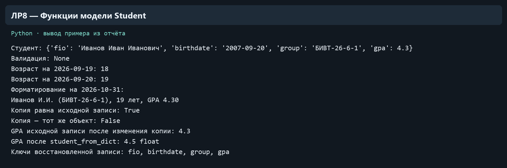
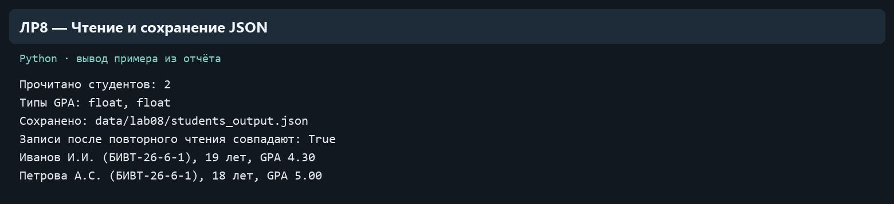
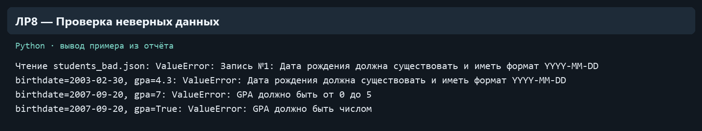
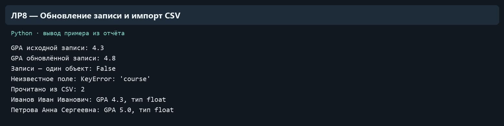

# ЛАБОРАТОРНАЯ РАБОТА №8

## ЗАДАНИЕ А — МОДЕЛЬ STUDENT

### ПРОВЕРКА ДАТЫ — VALIDATE_DATE

```python
def validate_date(birthdate: str) -> None:
    if not isinstance(birthdate, str):
        raise ValueError("Дата рождения должна быть строкой YYYY-MM-DD")
    try:
        value = datetime.date.fromisoformat(birthdate)
    except ValueError:
        raise ValueError("Дата рождения должна существовать и иметь формат YYYY-MM-DD") from None
    if value.isoformat() != birthdate:
        raise ValueError("Дата рождения должна иметь формат YYYY-MM-DD")
    if value > datetime.date.today():
        raise ValueError("Дата рождения не может быть в будущем")
```

Принимаем дату рождения строкой. Через `date.fromisoformat` проверяем существование даты, а сравнением с `isoformat()` — точный формат `YYYY-MM-DD`. Поэтому `2003-02-30`, запись без дефисов и будущая дата вызывают `ValueError` с причиной.

### ПРОВЕРКА ЗАПИСИ — VALIDATE_STUDENT

```python
def validate_student(rec: dict) -> None:
    if not isinstance(rec, dict) or set(rec) != set(STUDENT_FIELDS):
        raise ValueError("Нужны ровно поля fio, birthdate, group, gpa")
    if not isinstance(rec["fio"], str) or not rec["fio"].strip():
        raise ValueError("ФИО должно быть непустой строкой")
    if not isinstance(rec["group"], str) or not rec["group"].strip():
        raise ValueError("Группа должна быть непустой строкой")
    validate_date(rec["birthdate"])
    gpa = rec["gpa"]
    if isinstance(gpa, bool) or not isinstance(gpa, (int, float)):
        raise ValueError("GPA должно быть числом")
    if not 0 <= gpa <= 5:
        raise ValueError("GPA должно быть от 0 до 5")
```

Проверяем тип записи и сравниваем множества ключей, поэтому перестановка полей не считается ошибкой. ФИО и группа должны быть строками и оставаться непустыми после `strip()`. Дату проверяем через `validate_date`.

GPA должен быть числом `int` или `float` в диапазоне 0…5. Отдельно исключаем `bool`, поскольку в Python он является подклассом `int`. Успешная проверка возвращает `None` и не изменяет запись; при ошибке получаем `ValueError`.

### СОЗДАНИЕ ЗАПИСИ — MAKE_STUDENT

```python
def make_student(fio: str, birthdate: str, group: str, gpa: int | float) -> dict:
    rec = {"fio": fio, "birthdate": birthdate, "group": group, "gpa": gpa}
    validate_student(rec)
    return {
        "fio": " ".join(fio.split()),
        "birthdate": birthdate,
        "group": group.strip(),
        "gpa": float(gpa),
    }
```

Собираем словарь и передаём его в `validate_student`, чтобы конструктор выполнял те же проверки, что и готовая запись. После проверки убираем лишние пробелы в ФИО, обрезаем пробелы по краям группы и приводим GPA к `float`.

В `make_student` передаём числовой GPA, например `4.3` или `5`. Строку `"4.3"` здесь не принимаем: преобразование строк выполняется при импорте в `student_from_dict`.

### ПОЛНЫЙ ВОЗРАСТ — STUDENT_AGE

```python
def student_age(rec: dict, today=None) -> int:
    validate_student(rec)
    birthdate = datetime.date.fromisoformat(rec["birthdate"])
    if today is None:
        today = datetime.date.today()
    if not isinstance(today, datetime.date):
        raise ValueError("today должна быть датой")
    age = today.year - birthdate.year
    if (today.month, today.day) < (birthdate.month, birthdate.day):
        age -= 1
    if age < 0:
        raise ValueError("Дата расчёта возраста не может быть раньше даты рождения")
    return age
```

Проверяем запись и разбираем дату рождения. Если `today` не передан, берём `date.today()`. Сначала вычисляем разницу лет, затем сравниваем кортежи `(месяц, день)`. Если день рождения ещё не наступил, уменьшаем возраст на единицу.

Например, для даты рождения `2007-09-20` на `2026-09-19` получаем 18 лет, а на `2026-09-20` — 19 лет. Переданная дата расчёта позволяет проверить эти случаи независимо от текущего дня. Дату раньше рождения отклоняем. Для родившегося 29 февраля в невисокосный год возраст увеличивается 1 марта.

### КРАСИВЫЙ ВЫВОД — FORMAT_STUDENT

```python
def format_student(rec: dict) -> str:
    age = student_age(rec)
    parts = rec["fio"].split()
    initials = "".join(part[0].upper() + "." for part in parts[1:])
    name = f"{parts[0]} {initials}".strip()
    if 11 <= age % 100 <= 14:
        suffix = "лет"
    elif age % 10 == 1:
        suffix = "год"
    elif 2 <= age % 10 <= 4:
        suffix = "года"
    else:
        suffix = "лет"
    return f"{name} ({rec['group']}), {age} {suffix}, GPA {rec['gpa']:.2f}"
```

Разбиваем ФИО через `split()`, сохраняем фамилию целиком и собираем инициалы остальных частей. Возраст получаем через `student_age`. Для чисел с последними двумя цифрами 11–14 выбираем `лет`; в остальных случаях по последней цифре выбираем `год`, `года` или `лет`. GPA выводим с двумя знаками после точки.

Получаем строку вида `Иванов И.И. (БИВТ-26-6-1), 19 лет, GPA 4.30`. Возраст в этой строке зависит от текущей даты.

### КОПИЯ ДЛЯ СЕРИАЛИЗАЦИИ — STUDENT_TO_DICT

```python
def student_to_dict(rec: dict) -> dict:
    validate_student(rec)
    return rec.copy()
```

Проверяем запись и возвращаем `rec.copy()`. Значения сохраняются, но сам словарь получается новым: изменение GPA в копии не меняет исходную запись. Поверхностной копии достаточно, потому что поля содержат только строки и числа.

### ВОССТАНОВЛЕНИЕ ЗАПИСИ — STUDENT_FROM_DICT

```python
def student_from_dict(d: dict) -> dict:
    if not isinstance(d, dict):
        raise ValueError("Данные студента должны быть словарём")
    try:
        rec = {field: d[field] for field in STUDENT_FIELDS}
    except KeyError as error:
        raise ValueError(f"Не указано поле {error.args[0]}") from None
    if isinstance(rec["gpa"], bool) or not isinstance(rec["gpa"], (int, float, str)):
        raise ValueError("GPA должно быть числом")
    try:
        rec["gpa"] = float(rec["gpa"])
    except (TypeError, ValueError, OverflowError):
        raise ValueError("GPA должно быть числом") from None
    return make_student(**rec)
```

Принимаем словарь из внешнего источника и выбираем только ключи из `STUDENT_FIELDS`. Лишние поля не переносим, а при отсутствии обязательного поля вызываем `ValueError`, называя это поле.

GPA может прийти числом или строкой, поэтому приводим его к `float`. Значение `bool` отклоняем до преобразования. Затем вызываем `make_student`: проверяем диапазон GPA, строки и дату, нормализуем пробелы и возвращаем новую запись. Исходный словарь не изменяем.

### ПРИМЕРЫ РАБОТЫ МОДЕЛИ

Каждый пример ниже выполняем из корня репозитория в консоли Python. Блоки самостоятельные: в каждом указаны нужные импорты.

```python
import datetime
from src.lab08.models import (
    make_student, validate_student, student_age, format_student,
    student_to_dict, student_from_dict,
)

student = make_student("  Иванов   Иван Иванович  ", "2007-09-20", " БИВТ-26-6-1 ", 4.3)
print("Студент:", student)
print("Валидация:", validate_student(student))
for today in (datetime.date(2026, 9, 19), datetime.date(2026, 9, 20)):
    print(f"Возраст на {today}: {student_age(student, today)}")
print(f"Форматирование на {datetime.date.today()}:")
print(format_student(student))
copied = student_to_dict(student)
print("Копия равна исходной записи:", copied == student)
print("Копия — тот же объект:", copied is student)
copied["gpa"] = 5.0
print("GPA исходной записи после изменения копии:", student["gpa"])
restored = student_from_dict({**student, "gpa": "4.5", "extra": "лишнее поле"})
print("GPA после student_from_dict:", restored["gpa"], type(restored["gpa"]).__name__)
print("Ключи восстановленной записи:", ", ".join(restored))
```

Вывод запуска:

```text
Студент: {'fio': 'Иванов Иван Иванович', 'birthdate': '2007-09-20', 'group': 'БИВТ-26-6-1', 'gpa': 4.3}
Валидация: None
Возраст на 2026-09-19: 18
Возраст на 2026-09-20: 19
Форматирование на 2026-10-31:
Иванов И.И. (БИВТ-26-6-1), 19 лет, GPA 4.30
Копия равна исходной записи: True
Копия — тот же объект: False
GPA исходной записи после изменения копии: 4.3
GPA после student_from_dict: 4.5 float
Ключи восстановленной записи: fio, birthdate, group, gpa
```



## ЗАДАНИЕ Б — СЕРИАЛИЗАЦИЯ В JSON

Функции находятся в [serialize.py](serialize.py). Используем стандартные модули `json`, `csv`, `pathlib` и функции модели:

```python
import csv
import json
from pathlib import Path

from src.lab08.models import STUDENT_FIELDS, student_from_dict, student_to_dict
```

### СОХРАНЕНИЕ — STUDENTS_TO_JSON

```python
def students_to_json(students: list[dict], path: str | Path) -> None:
    if not isinstance(students, list):
        raise ValueError("Студенты должны быть списком записей")
    data = []
    for number, student in enumerate(students, start=1):
        try:
            data.append(student_to_dict(student))
        except ValueError as error:
            raise ValueError(f"Запись №{number}: {error}") from error
    output = json.dumps(data, ensure_ascii=False, indent=2)
    path = Path(path)
    path.parent.mkdir(parents=True, exist_ok=True)
    path.write_text(output, encoding="utf-8")
```

Принимаем список записей и путь типа `str` или `Path`. Каждую запись проверяем через `student_to_dict` и добавляем её копию в новый список. Если запись неверна, сообщаем её номер и причину.

Превращаем список в JSON через `json.dumps`: `ensure_ascii=False` сохраняет русские буквы напрямую, `indent=2` задаёт отступы в два пробела. Создаём недостающие родительские папки и записываем файл в UTF-8. Все записи проверяем до записи файла, поэтому неверные данные не стирают прежний результат. Исходный список не меняем.

### ЧТЕНИЕ — STUDENTS_FROM_JSON

```python
def students_from_json(path: str | Path) -> list[dict]:
    with Path(path).open(encoding="utf-8") as file:
        data = json.load(file)
    if not isinstance(data, list):
        raise ValueError("JSON должен содержать массив записей студентов")
    students = []
    for number, item in enumerate(data, start=1):
        try:
            students.append(student_from_dict(item))
        except ValueError as error:
            raise ValueError(f"Запись №{number}: {error}") from error
    return students
```

Открываем файл в UTF-8 и разбираем JSON через `json.load`. На верхнем уровне ожидаем массив, а каждый его элемент передаём в `student_from_dict`. Возвращаем список проверенных записей с GPA типа `float`. Пустой массив допустим и превращается в пустой список.

### JSON ДО И ПОСЛЕ ПРЕОБРАЗОВАНИЯ

Во входном файле [students_input.json](../../data/lab08/students_input.json) находятся две записи:

```json
[
  {
    "fio": "Иванов Иван Иванович",
    "birthdate": "2007-09-20",
    "group": "БИВТ-26-6-1",
    "gpa": "4.3"
  },
  {
    "fio": "Петрова Анна Сергеевна",
    "birthdate": "2008-03-08",
    "group": "БИВТ-26-6-1",
    "gpa": 5
  }
]
```

После чтения и сохранения в [students_output.json](../../data/lab08/students_output.json) получаем:

```json
[
  {
    "fio": "Иванов Иван Иванович",
    "birthdate": "2007-09-20",
    "group": "БИВТ-26-6-1",
    "gpa": 4.3
  },
  {
    "fio": "Петрова Анна Сергеевна",
    "birthdate": "2008-03-08",
    "group": "БИВТ-26-6-1",
    "gpa": 5.0
  }
]
```

Число записей и значения остальных полей сохраняются. Строковый GPA `"4.3"` становится числом `4.3`, а целое `5` — числом `5.0`. В обоих случаях в Python получаем `float`.

### ПРИМЕР ЧТЕНИЯ И СОХРАНЕНИЯ

```python
from pathlib import Path
from src.lab08.models import format_student
from src.lab08.serialize import students_from_json, students_to_json

students = students_from_json(Path("data/lab08") / "students_input.json")
students_to_json(students, Path("data/lab08") / "students_output.json")
restored = students_from_json(Path("data/lab08") / "students_output.json")
print("Прочитано студентов:", len(students))
print("Типы GPA:", ", ".join(type(student["gpa"]).__name__ for student in students))
print("Сохранено: data/lab08/students_output.json")
print("Записи после повторного чтения совпадают:", restored == students)
for student in restored:
    print(format_student(student))
```

Вывод запуска:

```text
Прочитано студентов: 2
Типы GPA: float, float
Сохранено: data/lab08/students_output.json
Записи после повторного чтения совпадают: True
Иванов И.И. (БИВТ-26-6-1), 19 лет, GPA 4.30
Петрова А.С. (БИВТ-26-6-1), 18 лет, GPA 5.00
```



### ПРОВЕРКА НЕВЕРНЫХ ДАННЫХ

В файле [students_bad.json](../../data/lab08/students_bad.json) первая запись содержит несуществующую дату `2003-02-30`, а вторая — GPA `7`:

```json
[
  {
    "fio": "Иванов Иван Иванович",
    "birthdate": "2003-02-30",
    "group": "БИВТ-26-6-1",
    "gpa": "4.3"
  },
  {
    "fio": "Петрова Анна Сергеевна",
    "birthdate": "2008-03-08",
    "group": "БИВТ-26-6-1",
    "gpa": 7
  }
]
```

Политика `strict` останавливает чтение на ошибке даты первой записи. Если исправить эту дату, следующей ошибкой станет GPA второй записи. Демонстрация отдельно показывает оба нарушения, чтобы остановка на первой ошибке не скрывала проверку среднего балла.

```python
from pathlib import Path
from src.lab08.models import make_student
from src.lab08.serialize import students_from_json

try:
    students_from_json(Path("data/lab08") / "students_bad.json")
except ValueError as error:
    print(f"Чтение students_bad.json: ValueError: {error}")
for birthdate, gpa in (("2003-02-30", 4.3), ("2007-09-20", 7), ("2007-09-20", True)):
    try:
        make_student("Иванов Иван Иванович", birthdate, "БИВТ-26-6-1", gpa)
    except ValueError as error:
        print(f"birthdate={birthdate}, gpa={gpa}: ValueError: {error}")
```

Вывод запуска:

```text
Чтение students_bad.json: ValueError: Запись №1: Дата рождения должна существовать и иметь формат YYYY-MM-DD
birthdate=2003-02-30, gpa=4.3: ValueError: Дата рождения должна существовать и иметь формат YYYY-MM-DD
birthdate=2007-09-20, gpa=7: ValueError: GPA должно быть от 0 до 5
birthdate=2007-09-20, gpa=True: ValueError: GPA должно быть числом
```



## ДОПОЛНИТЕЛЬНОЕ ЗАДАНИЕ СО ЗВЁЗДОЧКОЙ

### ОБНОВЛЕНИЕ ЗАПИСИ — UPDATE_STUDENT

```python
def update_student(rec: dict, **fields) -> dict:
    validate_student(rec)
    for field in fields:
        if field not in STUDENT_FIELDS:
            raise KeyError(field)
    updated = rec.copy()
    updated.update(fields)
    return make_student(**updated)
```

Проверяем исходную запись и названия изменяемых полей. Неизвестный ключ вызывает `KeyError`. Затем создаём копию, обновляем её поля через `update()` и передаём в `make_student` для проверки и нормализации значений. Неверное значение вызывает `ValueError`; исходная запись остаётся прежней.

### ИМПОРТ ИЗ CSV — STUDENTS_FROM_CSV

```python
def students_from_csv(path: str | Path) -> list[dict]:
    with Path(path).open(encoding="utf-8", newline="") as file:
        reader = csv.DictReader(file)
        header = reader.fieldnames
        if header is None or len(header) != len(STUDENT_FIELDS) or set(header) != set(STUDENT_FIELDS):
            raise ValueError("CSV должен содержать столбцы fio,birthdate,group,gpa")
        students = []
        for number, row in enumerate(reader, start=1):
            try:
                if None in row or any(value is None for value in row.values()):
                    raise ValueError("Число значений не совпадает с числом столбцов")
                students.append(student_from_dict(row))
            except ValueError as error:
                raise ValueError(f"Запись №{number}: {error}") from error
    return students
```

Открываем CSV с `newline=""` и читаем его через `csv.DictReader`. Проверяем, что заголовок содержит ровно поля `fio`, `birthdate`, `group`, `gpa`, без пропущенных, лишних или повторяющихся названий. Порядок столбцов может отличаться. Для каждой записи проверяем число значений и вызываем `student_from_dict`.

Все значения из CSV приходят строками. GPA превращается в число внутри `student_from_dict` через `float()`, после чего запись проверяет `make_student`. При ошибке используем `strict`: вызываем `ValueError` с номером записи и причиной.

Входной файл [students_input.csv](../../data/lab08/students_input.csv) содержит:

```csv
fio,birthdate,group,gpa
Иванов Иван Иванович,2007-09-20,БИВТ-26-6-1,4.3
Петрова Анна Сергеевна,2008-03-08,БИВТ-26-6-1,5
```

### ПРИМЕР ОБНОВЛЕНИЯ И ИМПОРТА CSV

```python
from pathlib import Path
from src.lab08.models import make_student, update_student
from src.lab08.serialize import students_from_csv

student = make_student("Иванов Иван Иванович", "2007-09-20", "БИВТ-26-6-1", 4.3)
updated = update_student(student, gpa=4.8)
print("GPA исходной записи:", student["gpa"])
print("GPA обновлённой записи:", updated["gpa"])
print("Записи — один объект:", updated is student)
try:
    update_student(student, course=1)
except KeyError as error:
    print(f"Неизвестное поле: KeyError: {error}")
students = students_from_csv(Path("data/lab08") / "students_input.csv")
print("Прочитано из CSV:", len(students))
for rec in students:
    print(f"{rec['fio']}: GPA {rec['gpa']}, тип {type(rec['gpa']).__name__}")
```

Вывод запуска:

```text
GPA исходной записи: 4.3
GPA обновлённой записи: 4.8
Записи — один объект: False
Неизвестное поле: KeyError: 'course'
Прочитано из CSV: 2
Иванов Иван Иванович: GPA 4.3, тип float
Петрова Анна Сергеевна: GPA 5.0, тип float
```

